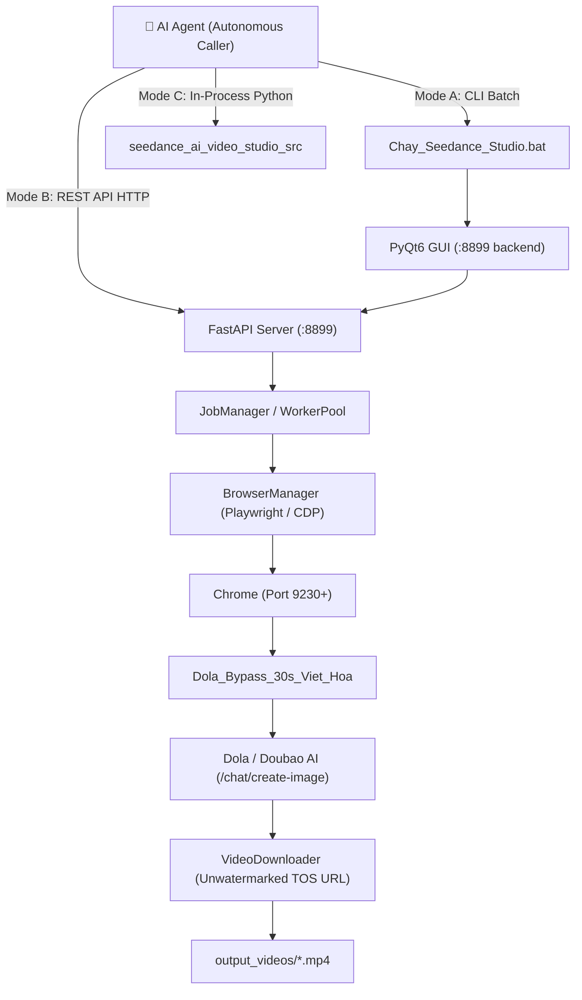

# 🤖 AI Agent Integration & Automation Guide
> **Seedance AI Video Studio PRO v5.0 — Autonomous Agent Operation Manual**
> Designed for AI Agents (Antigravity, Claude, ChatGPT, AutoGen, CrewAI, LangChain, and custom Python daemons).

---

## 1. System Architecture for AI Agents

Seedance AI Video Studio is an automated ecosystem designed to control **ByteDance / Dola AI** and render **30-second unwatermarked cinematic videos** using the **Dreamina Seedance 2.5 Pro** engine.



---

## 2. Execution Modes for AI Agents

### Mode A: 1-Click Launch via Launcher Script (Default)
Agents operating via shell/terminal (PowerShell or Bash) can launch the entire studio suite using:

```bat
d:\Seedance\seedance-ai-video-studio\Chay_Seedance_Studio.bat
```

**Under the hood, `Chay_Seedance_Studio.bat` automatically:**
1. Kills any zombie process occupying port `8899`.
2. Locates an existing Python environment with `PyQt6` and `FastAPI` (system Python 3.10, local venv, or PATH).
3. Launches `main_gui_pyqt.py` in `seedance_ai_video_studio_src`.
4. Spawns the embedded FastAPI background server on `http://127.0.0.1:8899`.

---

### Mode B: Headless REST API Server (Recommended for Automated Pipelines)
If the AI Agent wants to run headless without a Desktop GUI window, it can start the FastAPI backend directly:

```bash
cd seedance_ai_video_studio_src
python -m uvicorn api_server:app --host 127.0.0.1 --port 8899
```

#### REST API Endpoints Specification

| Method | Endpoint | Description |
| :--- | :--- | :--- |
| `GET` | `/api/status` | System health, worker pool capacity, active accounts. |
| `GET` | `/api/accounts` | List configured Dola accounts, login status & credits. |
| `POST` | `/api/accounts/import` | Add or update Dola account cookies. |
| `POST` | `/api/jobs/create` | Submit video generation job (single prompt or batch). |
| `GET` | `/api/jobs/{job_id}` | Poll rendering status (`queued`, `generating`, `completed`, `failed`). |
| `GET` | `/api/jobs/{job_id}/video` | Direct download URL / file path for the unwatermarked 30s MP4. |

#### Example: Job Creation Payload (`POST /api/jobs/create`)
```json
{
  "prompt": "Cinematic 30s video of a cybernetic warrior in heavy neon rain, 4-stage temporal pacing, 8k resolution",
  "model_version": "seedance_2.5",
  "duration": 30,
  "aspect_ratio": "9:16",
  "account_id": "auto",
  "reference_image_url": null,
  "bypass_watermark": true
}
```

---

### Mode C: In-Process Python Scripting

AI Agents can import and orchestrate the studio components directly:

```python
import sys
import os

# Add src to module search path
sys.path.insert(0, os.path.abspath("seedance_ai_video_studio_src"))

from account_manager import AccountManager
from browser_manager import BrowserManager
from dola_automation import DolaAutomation
from video_downloader import VideoDownloader

# 1. Initialize core managers
acc_mgr = AccountManager()
browser_mgr = BrowserManager()
automation = DolaAutomation()
downloader = VideoDownloader()

# 2. Pick an active account
account = acc_mgr.get_active_account()

# 3. Launch isolated browser session for Dola
driver = browser_mgr.launch_account_browser(account)

# 4. Generate 30s Seedance 2.5 video
result = automation.generate_video_30s(
    driver=driver,
    prompt="A magical crystal forest with glowing luminescent butterflies, 30s cinematic progression",
    ratio="16:9",
    duration=30  # Underlying payload automatically enforces duration: 31
)

# 5. Extract unwatermarked video
clean_video_url = downloader.get_clean_tos_url(result["video_url"])
output_path = downloader.download(clean_video_url, output_name="crystal_forest_30s.mp4")
print(f"Video saved to: {output_path}")
```

---

## 3. Seedance 2.5 Pro 30s Prompt Engineering Protocol

When generating prompts for Dola Seedance 2.5 Pro, diffusion models often cut motion short at 15s if the prompt is static. **The AI Agent MUST format prompts using the 4-Stage Temporal Pacing Protocol:**

```text
[00:00 - 00:05] Establishing & Hook:
Wide cinematic opening, subject posture established, volumetric atmospheric lighting, slow push-in camera motion.

[00:05 - 00:15] Dynamics & Development:
Main character action begins, physics in motion (hair, clothing, particles), smooth camera pan and tracking.

[00:15 - 00:25] Climax & Peak Motion:
Dramatic visual shift, maximum dynamic action, orbital low-angle sweep, intense lighting rays, peak cinematic flair.

[00:25 - 00:30] Resolution & Outro:
Movement decelerates smoothly, lingering heroic settling frame, soft depth-of-field hold, final aesthetic stillness.
```

### Negative Prompt Constraints (Always Enforce)
```text
Negative: text, subtitles, watermark, logo, morphing, jitter, duplicate limbs, abrupt frame cut, low resolution, blurry textures.
```

---

## 4. Key Configuration Parameters

- **`config.py`**:
  - `API_PORT`: `8899`
  - `CHROME_DEBUG_PORT_START`: `9230` (each worker increments port by 1).
  - `OUTPUT_DIR`: Defaults to `output_videos/`.
  - `EXTENSION_DIR`: Points to `Dola_Bypass_30s_Viet_Hoa`.
- **Server Bypass Override**:
  - In Dola backend, the parameter `duration: 31` renders a clean full `30.0` seconds without end-frame clipping.
  - Model version must always be specified as `seedance_v2.5` or `seedance_2.5`.

---

## 5. Agent Error Handling & Diagnostics

| Issue | Root Cause | AI Agent Action |
| :--- | :--- | :--- |
| `Port 8899 in use` | Zombie Python / uvicorn | Run `taskkill /F /PID <pid>` or call `Chay_Seedance_Studio.bat` (which does it automatically). |
| `User does not exist (用户不存在)` | Dola session expired | Re-authenticate via `import_user_cookies.py` or switch account in `accounts.json`. |
| `Shark Block detected` | ByteDance rate limit / IP flag | Rotate proxy via `proxy_manager.py` or switch account profile. |
| `Video truncated to 15s` | Model fell back to Fast 2.0 | Verify `duration: 31` and ensure Studio mode (`/chat/create-image`) is used instead of basic chat. |
